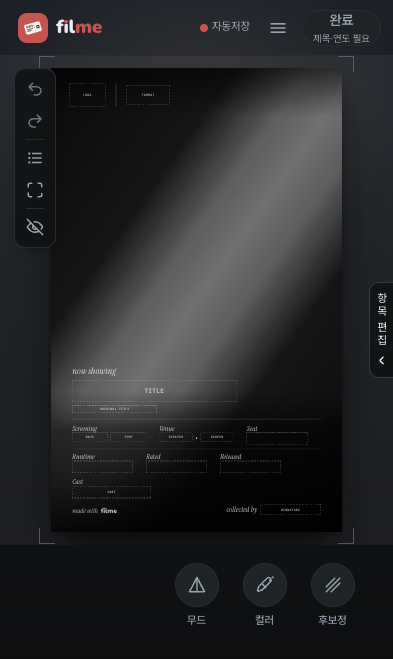
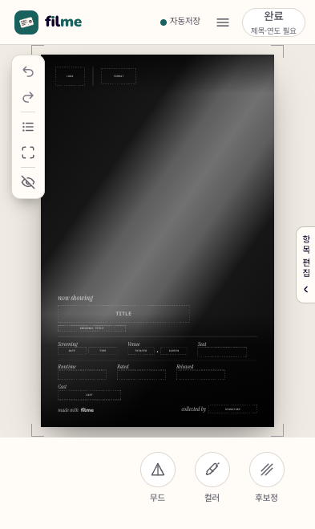
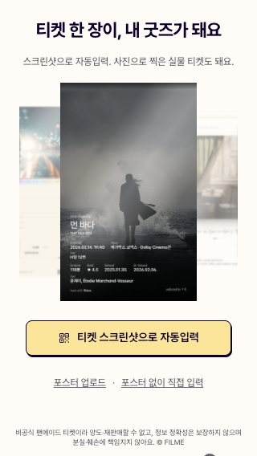
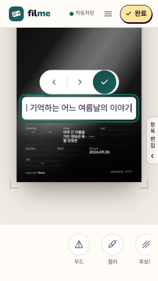
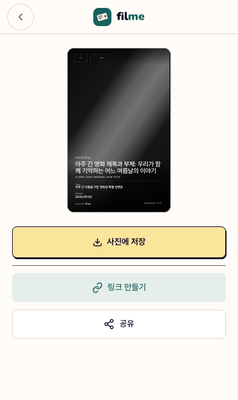

# FILME 모바일 UI 개편·제품 진단 — 2026-09-20

## 적용 범위

크림색 라이트 UI와 Pretendard를 랜딩·편집기·입력 패널·결과 화면에 적용했다. PC는 같은 모바일 셸을 좁은 프레임으로 제공한다. 티켓의 자연 픽셀 크기·서체·배치·재질은 그대로 두고, 사용자가 삭제 요청한 형압·하이라이트 효과만 제거했다.

이전 작업의 한글 입력 즉시 반영, 슬라이더 터치 영역, 선택 서체 미리보기, 자동저장 버튼 개선도 유지했다. Redis 재설계 및 OCR 인프라 복구는 이번 작업에서 보류했다. 기존 작업 중 변경 사항을 되돌리거나 커밋·배포하지 않았다.

## 변경과 판단

| 항목 | 확인한 문제 | 적용한 변경 / 근거 |
| --- | --- | --- |
| UI 일관성 | 편집기와 결과 화면의 테마가 달랐고 결과 화면은 항상 다크였다 | 크림 `#fffcf7` 단일 테마. 기존 다크 저장값·OS 다크 설정에서도 동일. 버터색 주요 버튼, 청록색 선택·포커스 |
| 입력 가독성 | 티켓 조판을 흉내 내는 투명 입력은 작은 글자·여러 줄·긴 값에서 커서와 실제 표시가 어긋날 수 있었다. 새 불투명 선택 배경을 적용하자 글자도 가려졌다 | 16px Pretendard 입력에 원문을 표시하고 네이티브 가로 스크롤 사용. 티켓 조판은 미리보기 전용. 폰트·자간 복제 및 역배율 계산 제거 |
| 편집 도구 겹침 | 확대된 입력칸의 왼쪽을 플로팅 툴바가 덮었다 | 편집 중에는 전용 필드바를 표시하고 플로팅 툴바는 마운트를 유지한 채 숨김. 편집 완료 시 복귀 |
| 선택 표시 | 티켓의 흰 잉크색이 선택 링에도 쓰여 밝은 UI에서 식별이 어려웠다 | 티켓 색상과 독립된 청록색 링 사용 |
| 동작 줄이기 | 샘플을 여러 줄로 나열해 320px 화면에서 주요 시작 버튼이 아래로 밀렸다 | 자동 전환 없는 한 줄 가로 스크롤 목록. 일반 설정에서는 큰 캐러셀과 기존 느린 전환 유지 |
| 늦은 영화 상세 응답 | 검색 패널을 닫은 뒤에도 상세 요청이 `apply()`를 호출할 수 있었다 | 훅 정리 시 요청 세대 무효화. 패널을 닫은 뒤 응답해도 기본 필드 반영 1회만 남는 회귀 테스트 |
| 내보내기 실패 복구 | `html-to-image` 로딩 전에 미리보기 배경을 투명하게 바꿨고, 로딩 실패는 복원 `finally` 바깥이었다 | 모듈을 먼저 불러온 후 배경 변경. 캡처 자체의 `finally` 복원은 유지 |
| 형압·하이라이트 | 사용자 삭제 요청 | UI, 브러시·올가미, 세션 상태, 6개 무드 전달 속성, DOM 마스크, JPEG 합성, 전용 검사와 캡처 옵션 삭제. 마스크는 저장 초안에 포함되지 않아 마이그레이션 불필요 |

### YAGNI 판정

**Strong — 실제 소비자가 사라진 코드를 제거하는 것이 맞다.** 형압 전용 모듈·옵션뿐 아니라 미사용 데스크톱 위저드용 `onDetailPending`, 그 상태와 effect, 단일 라이트 UI에서 불필요한 테마 상태·동기화·어두운 배경, 사용하지 않는 결과 등장 애니메이션을 정리했다.

반면 입력 디바운스, 자동저장과 Blob URL 수명 관리, 캡처 오류 복구, 요청 제한을 복잡하다는 이유로 제거하지 않았다. 각각 입력 반응성·데이터 보존·메모리·결과물·외부 호출 보호에 현재 소비자가 있다. Redis 자체의 필요성은 별도 후속 판단 대상이다.

## 검증

- `bun run typecheck`, `bun run lint`, `bun run build` 통과.
- `bun run test`: 1,248개 통과. 삭제한 효과 전용 테스트 때문에 이전보다 개수는 줄었다.
- `scripts/measure-mobile-editor.mjs`: 320×568, 375×667, 393×659, 414×736에서 헤더·입력 반영·슬라이더 터치/드래그·서체 선택·자동저장 검사 통과. [측정값](after.json)
- `scripts/verify-mobile-ui.mjs`: 같은 4개 크기에서 기존 다크 저장값 + OS 다크 설정, 동작 줄이기, 긴 제목 원문 유지, 입력 16px, 입력 좌·중·우 hit test, 필드 목록, 결과 화면과 저장 버튼 접근 검사 통과. [측정값](ui-flow.json)
- `scripts/measure-chrome.mjs`: 기존 400×675 모달 포커스·닫기·클릭 통과 방지·명암비·프레임·랜딩 예산·배너/토스트 충돌 게이트도 전부 통과. [측정값](chrome-regression.json)
- 실제 브라우저에서 6개 JPEG를 생성해 전후 비교했다. 4종은 디코딩한 픽셀이 동일했고 Minimal·Stub은 최대 채널 차이 2였다. 기존 비교 하네스 허용값 3을 넘는 픽셀은 0개다. [비교값](jpeg-comparison.json)
- 형압 없는 기본값끼리 비교한 결과다. 삭제한 효과가 들어간 저장물의 동일성이나 모든 재질 조합의 픽셀 동일성을 주장하지 않는다.
- Stub 전체 필드 저장물의 Film 헤더는 y=1191.8–1211.3, 기존 배경 스탬프 박스 y=1060–1102와 겹치지 않았다. [JPEG](after-stub-full.jpg)
- Artpaper + Gloss를 함께 적용한 실제 JPEG 생성 및 두 합성 로그 확인. [JPEG](after-artpaper-gloss.jpg)

| 무드 | JPEG 크기 | 최대 채널 차이 |
| --- | --- | --- |
| Minimal | 1960×3108 | 2 |
| Criterion | 1960×3108 | 0 |
| 35mm | 1960×3108 | 0 |
| Editorial | 3108×1960 | 0 |
| Stub | 1960×3108 | 2 |
| 35mm Wide | 3108×1960 | 0 |

### 화면 비교

| 개편 전 편집기 | 개편 후 편집기 |
| --- | --- |
|  |  |

| 320px 랜딩 | 긴 제목 편집 | 결과 화면 |
| --- | --- | --- |
|  |  |  |

[동작 줄이기 랜딩](ui-320-landing-reduced.png) · [필드 목록](ui-320-fields.png)

## 추가 기능 제안

**Leaning — 포스터 교체 취소 시 이전 원본 복원**이 가장 근거 있는 후속 개선이다. 현재 `usePosterCrop.openFile()`은 새 파일을 선택할 때 기존 원본 URL을 해제하고, 교체를 취소하면 재크롭이 비활성화된다(`posterCropPipeline.test.tsx`에 명시된 현재 계약). 기존 티켓은 남지만 재크롭하려면 다시 업로드해야 한다.

추가한다면 기존 원본과 교체 후보를 확정 전까지 분리하고, 취소 시 이전 원본을 유지해야 한다. 자동저장 중 후보 이미지가 이전 포스터 원본으로 저장되지 않도록 수명·저장 계약을 함께 바꿔야 하므로 이번 시각 개편에 섞지 않았다. 이 외에 새 상태 관리 라이브러리, 다중 문서 기능, 신규 LLM 추상 계층은 현재 근거만으로 추가하지 않는다.

## 확인 범위의 한계

이 기록은 로컬 프로덕션 빌드와 Chrome 모바일 에뮬레이션의 증거다. 실제 iPhone Safari의 키보드·공유 시트·JPEG 검증을 대신하지 않는다. CoreDevice 조회는 서비스 연결 오류/타임아웃으로 끝났고, 권한 범위를 넓힌 재조회도 완료되지 않아 중단했다. 기기가 없다고 판정한 것은 아니다.

이전 버전에서 사용자가 직접 확인한 한글 입력·삭제·되돌리기 및 키보드 위 도구 조작 결과는 유지하되, 이번 입력 UI 변경의 실기기 검증 결과로 재사용하지 않는다. OCR 실제 HTTP 200과 배포 환경 공유 링크 생성은 보류된 Redis 인프라 문제 때문에 이번 완료 기준에 포함하지 않았다. 다크 팔레트 후보도 후속 작업으로 남긴다.
